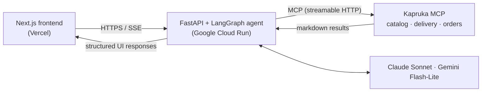
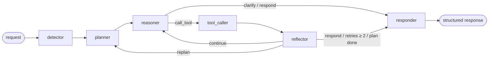

<div align="center">

# Kapru - AI Shopping Agent Backend

**A multilingual, agentic shopping assistant for [Kapruka](https://www.kapruka.com), Sri Lanka's largest e-commerce platform.**

Kapru takes a shopper from *"I need a birthday gift for my mom"* to a real, placed order — searching the live catalog, narrowing by budget and brand, checking delivery, and creating the order — all through conversation, in English, Sinhala, Tamil, Singlish or Tanglish.

[](https://www.python.org/)
[](https://fastapi.tiangolo.com/)
[](https://langchain-ai.github.io/langgraph/)
[](https://modelcontextprotocol.io/)
[](https://cloud.google.com/run)
[](https://github.com/samudaediriweera/kapruka-agent-backend/actions/workflows/deploy.yml)

[**Live demo**](https://kapruka-agent-eosin.vercel.app) · [Architecture](#architecture) · [API](#api-reference) · [Deployment guide](docs/DEPLOYMENT.md)

</div>

---

## Highlights

- **Plan → act → reflect agent loop.** A six-node LangGraph state machine plans each turn, calls tools, evaluates the result, and re-plans on failure — with hard loop guards so it never spins.
- **Real data, never invented.** Every product, price, delivery quote and order comes from Kapruka's live system over the **Model Context Protocol (MCP)**. Prompts are grounded in the real category taxonomy so the agent never claims an item is "unavailable" without searching.
- **End-to-end commerce.** Discovery → budget brackets → brand filter → product cards → delivery check → structured checkout form → **real order creation** and order tracking.
- **Data-driven price brackets.** Budget options are computed from the actual price distribution (quartiles) of live search results — not hard-coded ranges.
- **Five languages.** Replies in the exact language and script the user writes in: English, Sinhala, Singlish, Tamil, Tanglish.
- **Hybrid model routing.** Claude Sonnet (temperature 0.2) handles reasoning and tool decisions; Gemini Flash-Lite (temperature 0.7) writes the warm, conversational copy — precision where it matters, personality where it shows.
- **Real-time streaming.** Server-Sent Events push live, context-aware status updates (*"Searching Kapruka for chocolates…"*, *"Checking delivery to Kandy…"*) while the agent works.
- **Prompt-injection hardening.** Persona lock, system-prompt confidentiality, and user-supplied fields (names, addresses) treated strictly as data.
- **Production deployment.** Multi-stage Docker image, GitHub Actions CI/CD to Google Cloud Run, secrets in Google Secret Manager.

---

## Architecture



The backend is **stateless**: the frontend sends the conversation plus session state (cart, budget, delivery details) on each turn and receives the updated state back. This keeps Cloud Run instances disposable and horizontally scalable.

### Agent graph



| Node | Responsibility |
|---|---|
| **detector** | Classifies intent (`search_product`, `create_order`, `track_order`, `get_advice`, …) and works out which details are still missing. |
| **planner** | Breaks the turn into concrete steps for the current intent. |
| **reasoner** | Chooses the next action — call a specific MCP tool with parameters, ask a clarifying question, or respond. |
| **tool_caller** | Executes the MCP call, parses results, and caches products to avoid duplicate calls. |
| **reflector** | Judges the tool result: `continue`, `replan`, or `respond`. |
| **responder** | Produces a typed UI payload in the user's language. |

**Loop safety:** the reflector router forces a response after two failed attempts or once the plan is exhausted, so a misbehaving tool can never trap the agent in a loop.

### Kapruka MCP integration

[`agent/tools.py`](agent/tools.py) is the only module that talks to Kapruka. It uses the official MCP Python SDK over streamable HTTP and wraps these tools:

| MCP tool | Used for |
|---|---|
| `kapruka_search_products` | Catalog search with category, price, stock and sort filters |
| `kapruka_get_product` | Product detail — used to enrich search results with images (fetched concurrently) |
| `kapruka_list_categories` | Category taxonomy |
| `kapruka_list_delivery_cities` / `kapruka_check_delivery` | City lookup and delivery quotes |
| `kapruka_create_order` | Real order creation |
| `kapruka_track_order` | Order status |

Kapruka returns **markdown, not JSON**, so the client includes a parser that turns product listings into structured records (ID, name, price, URL, stock).

### Structured responses

The agent never returns free text to the UI. Every reply is a typed payload the frontend renders as a component:

| `type` | Rendered as |
|---|---|
| `product_cards` | Product carousel with images, prices and quick replies |
| `question` | Message with quick-reply chips (e.g. budget brackets, brands) |
| `input_form` | Checkout form with only the fields still missing |
| `delivery_quote` | Delivery fee and arrival estimate |
| `cart_summary` | Line items, subtotal, delivery and total |
| `order_confirmation` | Order ID, payment link and delivery time |
| `text` | Plain conversational reply |

---

## Tech stack

| Layer | Technology |
|---|---|
| API | FastAPI, Uvicorn, Pydantic v2, Server-Sent Events |
| Agent orchestration | LangGraph, LangChain Core |
| LLMs | Anthropic Claude Sonnet (reasoning), Google Gemini Flash-Lite (copywriting) |
| Commerce integration | Model Context Protocol (MCP) Python SDK |
| Tooling | Python 3.13, `uv` |
| Infrastructure | Docker (multi-stage), Google Cloud Run, Artifact Registry, Secret Manager |
| CI/CD | GitHub Actions |

---

## Getting started

### Prerequisites

- Python **3.13+**
- [`uv`](https://docs.astral.sh/uv/) package manager
- An [Anthropic API key](https://console.anthropic.com/) and a [Gemini API key](https://aistudio.google.com/apikey)

### Run locally

```bash
git clone https://github.com/samudaediriweera/kapruka-agent-backend.git
cd kapruka-agent-backend

# Install dependencies
uv sync

# Configure environment
cp .env.example .env   # then fill in your API keys

# Start the dev server
uv run uvicorn main:app --reload
```

The API is now at `http://localhost:8000`, with interactive docs at `http://localhost:8000/docs`.

### Run with Docker

```bash
docker build -t kapru-backend .
docker run --env-file .env -p 8080:8080 kapru-backend
```

### Environment variables

| Variable | Required | Description |
|---|---|---|
| `ANTHROPIC_API_KEY` | Yes | Claude — reasoning and tool selection |
| `GEMINI_API_KEY` | Yes | Gemini — conversational copy |
| `KAPRUKA_MCP_URL` | No | MCP endpoint (default `https://mcp.kapruka.com/mcp`) |

---

## API reference

| Method | Endpoint | Description |
|---|---|---|
| `POST` | `/api/chat/stream` | Run one agent turn, streaming status updates and the final response over SSE |
| `POST` | `/api/chat` | Run one agent turn and return the final response as JSON |
| `GET` | `/api/health` | Health check |
| `GET` | `/` | Service info |

### Example

```bash
curl -N -X POST http://localhost:8000/api/chat/stream \
  -H "Content-Type: application/json" \
  -d '{
        "messages": [{ "role": "user", "content": "I need a birthday cake for my mom in Kandy" }],
        "language": "en"
      }'
```

Stream output:

```text
data: {"type": "status", "node": "detector",    "label": "Understanding what you're looking for…"}
data: {"type": "status", "node": "tool_caller", "label": "Searching Kapruka for birthday cake…"}
data: {"type": "status", "node": "reflector",   "label": "Found 6 options, reviewing…"}
data: {"type": "final",  "response": { "type": "product_cards", "message": "...", "products": [ ... ] }, "state": { ... }}
```

Send the returned `state` back with the next request to continue the conversation. Fields include `cart`, `price_range`, `selected_brand`, `cached_products`, `delivery_info`, `recipient`, `sender`, `gift_message`, `intent` and `missing_info`.

---

## Deployment

Every push to `main` triggers the GitHub Actions pipeline:

1. Build the multi-stage Docker image, tagged with the commit SHA.
2. Push it to Google Artifact Registry.
3. Deploy to Cloud Run, injecting API keys from Secret Manager.

SHA-tagged images make rollback a single `gcloud run deploy` command. See **[docs/DEPLOYMENT.md](docs/DEPLOYMENT.md)** for the full setup, cost model, and production hardening roadmap.

---

## Project structure

```
kapruka-agent-backend/
├── main.py                 # FastAPI app, CORS, router mounting
├── api/
│   └── routes.py           # /chat, /chat/stream (SSE), /health
├── agent/
│   ├── graph.py            # LangGraph wiring and conditional routers
│   ├── nodes.py            # detector, planner, reasoner, tool_caller, reflector, responder
│   ├── state.py            # Typed shared agent state
│   └── tools.py            # Kapruka MCP client, markdown parsing, price brackets
├── docs/
│   └── DEPLOYMENT.md       # CI/CD and Cloud Run guide
├── .github/workflows/
│   └── deploy.yml          # Build → push → deploy pipeline
├── Dockerfile              # Multi-stage uv build
└── pyproject.toml
```

---

## Roadmap

- [ ] Automated test suite (`pytest`) gating the deploy pipeline
- [ ] Workload Identity Federation in place of a stored service-account key
- [ ] Staging environment with manual promotion to production
- [ ] Structured logging and agent tracing dashboards
- [ ] Health-check-gated rollouts on Cloud Run

---

## Author

**Samuda Ediriweera** · [GitHub](https://github.com/SamudaEdiriweera)

Built on Kapruka's public MCP server. Kapruka is a trademark of its respective owner; this is an independent project.
